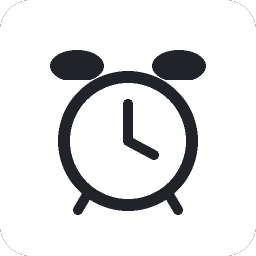

<p align="center"></p>

# Daymark

一个轻巧的个人待办与日程应用，支持 **Windows 和 macOS**。完成一件事，勾选一下；需要安排时间时，就打开日历。

**[下载最新版本](https://github.com/mycroftho/daymark/releases/latest)** · [所有 Release](https://github.com/mycroftho/daymark/releases) · [报告问题](https://github.com/mycroftho/daymark/issues)

## 下载与安装

| 系统 | 下载文件 | 使用方式 |
| --- | --- | --- |
| Windows x64 | `Daymark-Setup-1.2.0.exe` | 运行安装程序，可选择安装盘和目录 |
| Mac：Apple silicon / Intel | `Daymark-1.2.0-mac-universal.dmg` | 打开 DMG，将 Daymark 拖入 Applications |

每次 Release 同时提供 Windows、Mac 安装包和 `SHA256SUMS.txt`。源码 ZIP 不是安装包，请在 Release 的 **Assets** 中下载。

当前构建没有商业签名证书。Mac 版采用临时签名，**尚未经过 Apple Developer ID 签名与公证**，macOS 可能拦截打开。有关系统提示请参阅 [Apple 官方说明](https://support.apple.com/guide/mac-help/open-a-mac-app-from-an-unknown-developer-mh40616/mac)。项目不会声称未完成的签名或公证已经通过。

## 功能

- **待办**：新建、编辑、单击完成，10 秒 Undo，或从 History 恢复。
- **日程**：开始时间、Duration（分钟）、自动计算结束时间、地点与多行 Notes；支持跨午夜。
- **日历**：日／周／月视图；上午、下午、晚间分区；卡片显示时段、时长、地点、分类和备注摘要，点击查看详情。
- **分类与优先级**：Class、Meeting、Personal、Leisure 彩色标签；独立的优先级细线。
- **提醒**：系统通知、应用内提醒、Snooze 5 min；轻柔提示音可单独关闭或调整音量。
- **外观**：White、Dark、Pink、Blue、Green 五种主题，字体、字号和面板透明度可调。
- **数据**：保存在本机，提供 JSON 备份导出和合并导入，不需要注册账号。

## History 怎么搜索

1. 打开 **History**，在 **Search completed tasks** 中输入关键词。
2. 搜索会匹配标题、备注、地点、分类和日期；还可以按分类、完成日期范围缩小结果。
3. 结果出现在搜索及筛选区域**下方**，按完成日期分组，显示匹配数与总完成数。
4. **Clear filters** 恢复完整记录；取消任务的勾选可将它恢复到 Tasks。

History 只显示已完成任务，日期筛选使用的是**完成日期**。它与 Tasks、Calendar 分别保留各自的搜索和分类状态，不会互相影响。

## 提醒与提示音

在 **Appearance & reminders** 中：

- 开启 **Send system notifications**，点击 **Send test notification** 测试系统通知。
- **Play a gentle beep** 控制提示音，Volume 控制音量，**Test sound** 可以试听。
- 同一批到期任务只响一次；延后后可以再次提醒。系统通知和提示音开关相互独立。

关闭窗口后，应用仍在 Windows 托盘或 Mac 菜单栏运行。选择 **Quit Daymark** 才会完全退出并停止提醒。应用不默认开机自启。电脑睡眠、浏览器暂停和系统勿扰模式可能影响提醒；恢复运行后会重新检查到期任务。

Windows 使用固定通知身份和开始菜单快捷方式，收到系统 `shown` 回执后才记录为已显示。请在系统设置中检查 Daymark 的横幅、通知和 Focus / Do Not Disturb；Mac 需要在系统设置中允许 Daymark 通知。

## 数据与备份

| 平台 | 数据位置 |
| --- | --- |
| Windows 安装版 | 安装目录同级的 `DaymarkData` 文件夹。例如安装到 `D:\Software\Daymark` 时，数据保存在 `D:\Software\DaymarkData` |
| macOS | 当前用户的 `~/Library/Application Support/Daymark` |
| 网页版 | 当前浏览器的 localStorage，与桌面版独立 |

主数据文件保留兼容名称 `still-data.json`。升级时不要删除数据文件夹；卸载程序不会主动删除它。迁移设备或从网页切换到桌面版时，先 **Export backup**，再在新环境 **Import backup**。导入仅新增不存在的任务，不覆盖已有任务。

## 本地开发与网页预览

需要 Node.js 24，依赖使用 lockfile 固定：

```sh
npm ci
npm run check
npm start
```

网页无需构建工具：

```sh
python -m http.server 5173
```

打开 `http://localhost:5173/` 使用自己的浏览器数据；`http://localhost:5173/?preview=1` 使用隔离样例。网页提示音需要一次用户交互或点击 Test sound，页面关闭后无法提醒。透明度仅调整面板，不代表操作系统窗口透明。

## 构建和发布

```sh
# Windows x64：在 Windows 上执行
npm run dist

# macOS 通用版：在 macOS 上执行
npm run dist:mac
```

产物位于 `release/`。图标可用 `python scripts/generate-icons.py` 重新生成。

推送与 `package.json` 一致的 `v*` 标签，会触发 GitHub Actions：分别在 Windows 和 macOS 上检查、打包、启动隔离桌面自检，两个平台都成功后才发布 Release。Mac 的构建成功不代表已在真实 Mac 上测试过通知。

桌面自检检查页面加载、preload 接口、本地保存与 Node 隔离，使用独立的 `.desktop-test` 数据目录，不访问真实待办。

## 项目结构

```text
app.js / index.html / style.css  界面与交互
desktop/                        桌面窗口、通知、托盘与调度
build/                          原创图标与 Windows 安装配置
scripts/                        图标生成、构建自检和校验和工具
.github/workflows/              双平台 Release 流程
smoke-test.cjs                   界面逻辑回归检查
```

## License

[MIT](LICENSE)。第三方组件遵循各自的许可证。
